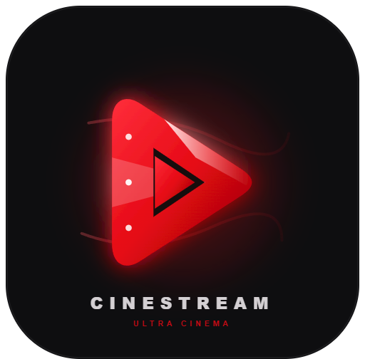

# 🎬 CineStream — Modern Dark-Themed Movie Streaming Platform

<div align="center">



**Nền tảng xem phim trực tuyến hiện đại với giao diện Dark-Cinema, hỗ trợ Multi-Profile, Video Streaming HTTP 206 Partial Content, Continue Watching và Cloudflare Edge Deployment.**

[](https://nodejs.org/)
[](https://vitejs.dev/)
[](https://expressjs.com/)
[](https://www.prisma.io/)
[](https://sqlite.org/)
[](https://pages.cloudflare.com/)

[Tính năng nổi bật](#-tính-năng-nổi-bật) •
[Kiến trúc công nghệ](#-kiến-trúc-công-nghệ) •
[Cơ sở dữ liệu](#-mô-hình-cơ-sở-dữ-liệu-erd) •
[Cài đặt & Khởi chạy](#-hướng-dẫn-cài-đặt--khởi-chạy) •
[Tài liệu API](#-danh-sách-api-endpoints) •
[Báo cáo đồ án](#-tài-liệu-báo-cáo-đồ-án)

</div>

---

## 📖 Giới thiệu tổng quan

**CineStream** là dự án nền tảng xem phim trực tuyến (OTT/VOD Streaming Web Application) được xây dựng theo phong cách thiết kế **Cinema Dark Theme** cao cấp, lấy cảm hứng từ các dịch vụ hàng đầu như Netflix, Disney+ và Apple TV+.

Hệ thống cung cấp giải pháp trọn vẹn từ trải nghiệm người dùng phía máy khách (Client-side) đến dịch vụ phát luồng video và quản lý dữ liệu phía máy chủ (Server-side):
- Trình phát video chuyên nghiệp hỗ trợ **HTTP 206 Partial Content** (cho phép tua video tức thời, tiết kiệm băng thông).
- Mô hình **Đa hồ sơ người xem (Multi-Profile)** độc lập trên cùng một tài khoản gia đình.
- Tự động ghi nhớ mốc thời gian đang xem dở (**Continue Watching / Watch Progress**).
- Danh sách phim yêu thích cá nhân (**My List / Watchlist**).
- Hỗ trợ triển khai linh hoạt: vừa chạy Node.js/Express truyền thống, vừa sẵn sàng cho hạ tầng **Serverless Cloudflare Pages & D1 Database**.

---

## ✨ Tính năng nổi bật

### 👤 1. Quản lý Tài khoản & Đa hồ sơ (Multi-Profile)
- **Đăng ký & Đăng nhập**: Xác thực tài khoản an toàn với cơ chế băm mật khẩu và quản lý phiên.
- **Hồ sơ độc lập**: Một tài khoản có thể tạo nhiều Profile với tên và Avatar tùy biến.
- **Chế độ Trẻ em (Kids Mode)**: Cờ `isKids` tự động lọc nội dung an toàn phù hợp lứa tuổi.
- **Gói cước VIP**: Quản lý các hạng thành viên (*Standard, VIP, Ultra 4K CineVIP*).

### 🎞️ 2. Danh mục Phim & Khám phá nội dung (Catalog Discovery)
- **Hero Banner tiêu điểm**: Tự động phát trailer nền với thông tin phim nổi bật (*Featured Movies*).
- **Phân loại đa dạng**: Phim lẻ (*Movies*), Phim bộ nhiều tập (*Series/Seasons/Episodes*), Thịnh hành (*Trending Now*), Phim chuẩn IMAX.
- **Lọc & Tìm kiếm tức thì**: Lọc theo thể loại (*Action, Sci-Fi, Drama, Animation...*) và tìm kiếm theo từ khóa tiêu đề, đạo diễn, diễn viên.

### 🎥 3. Trình phát Video Rạp hát (Cinema Player Dock)
- **HTTP 206 Partial Content Range Streaming**: Phát video mượt mà, hỗ trợ tua tới bất kỳ đoạn nào trong video mà không cần tải toàn bộ tệp.
- **Giao diện điều khiển rạp phim**: Play/Pause, tua nhanh 10 giây, thanh âm lượng, chế độ rạp chiếu (Theater mode), toàn màn hình (Fullscreen).
- **Điều hướng tập phim Series**: Xem danh sách tập, chuyển tập kế tiếp mượt mà ngay trong trình phát.

### ⏱️ 4. Cá nhân hóa trải nghiệm (Personalization)
- **Tiến độ xem dở (Continue Watching)**: Tự động lưu mốc thời gian xem `currentTime` và tính `%` tiến độ vào cơ sở dữ liệu mỗi 5 giây và khi thoát trang.
- **Danh sách của tôi (My List / Watchlist)**: Thêm/gỡ phim yêu thích chỉ với 1 cú nhấp, đồng bộ theo từng hồ sơ người xem.

### ☁️ 5. Kiến trúc Serverless & Edge Ready
- Tương thích kép: chạy máy chủ Node.js cục bộ hoặc triển khai toàn cầu qua **Cloudflare Pages Functions** và cơ sở dữ liệu phân tán **Cloudflare D1**.

---

## 🛠️ Kiến trúc công nghệ

```
cinestream/
│
├── 🎨 FRONTEND (Client Layer)
│   ├── Vite 6 + Vanilla JS + HTML5 Modern
│   ├── Tailwind CSS + Custom Dark Theme (css/theme.css)
│   └── Component Modular Injection (vite-plugin-html-inject)
│
├── ⚙️ BACKEND (Application / Business Layer)
│   ├── Node.js + Express 5 (server/index.js)
│   ├── HTTP 206 Range Video Streamer (server/routes/stream.js)
│   └── Cloudflare Pages Functions (functions/api/*)
│
└── 🗄️ DATABASE (Data Layer)
    ├── Prisma ORM 7.x
    ├── Local Database: SQLite (prisma/dev.db)
    └── Production Database: Cloudflare D1 (Serverless Edge SQL)
```

---

## 🗄️ Mô hình Cơ sở dữ liệu (ERD)

Cơ sở dữ liệu của CineStream được thiết kế chuẩn hóa quan hệ (RDBMS) gồm **06 bảng chi tiết**:

| STT | Tên bảng | Mô tả chức năng | Quan hệ liên kết |
|:---:|:---|:---|:---|
| 1 | **`User`** | Tài khoản khách hàng đăng ký, email, mật khẩu băm, gói cước | 1 - N với `Profile` |
| 2 | **`Profile`** | Hồ sơ người xem của từng thành viên, avatar, cờ trẻ em `isKids` | N - 1 với `User`; 1 - N với `WatchProgress`, `WatchlistItem` |
| 3 | **`Movie`** | Danh mục phim lẻ & series, slug, thể loại, poster, backdrop, rating | 1 - N với `Episode`, `WatchProgress`, `WatchlistItem` |
| 4 | **`Episode`** | Chi tiết từng tập phim thuộc Series (Season, số tập, videoUrl) | N - 1 với `Movie` (`seriesId`, Cascade Delete) |
| 5 | **`WatchProgress`** | Ghi nhận tiến độ xem dở (`currentTime`, `duration`, `% progress`) | N - 1 với `Profile`, N - 1 với `Movie` |
| 6 | **`WatchlistItem`** | Danh sách phim đánh dấu yêu thích của từng hồ sơ (My List) | N - 1 với `Profile`, N - 1 với `Movie` |

> 📷 **Sơ đồ ERD trực quan**: Xem hình ảnh chi tiết tại `cinestream_erd.png` hoặc `C:\Users\dinhh\Downloads\image.jpg`.

---

## 📁 Cấu trúc thư mục dự án

```text
cinestream/
├── css/
│   └── theme.css              # Phong cách Dark-Cinema & hiệu ứng giao diện
├── data/
│   └── movies.json            # Dữ liệu hạt giống (seed catalog)
├── functions/api/             # Cloudflare Pages Serverless Edge API
│   ├── movies/                # API danh mục phim
│   ├── stream/                # API luồng phát trực tuyến
│   └── user/                  # API người dùng, watchlist, progress
├── js/
│   ├── db.js                  # Lớp truy vấn dữ liệu client
│   ├── mascot.js              # Linh vật tương tác trang
│   ├── nav.js                 # Điều hướng & thanh header
│   ├── player.js              # Trình phát video chuyên dụng
│   └── store.js               # Quản lý trạng thái phiên làm việc
├── pages/                     # Các trang màn hình giao diện
│   ├── 404.html               # Trang báo lỗi 404
│   ├── about.html             # Trang giới thiệu
│   ├── checkout.html          # Trang thanh toán gói cước
│   ├── contact.html           # Trang liên hệ
│   ├── help.html              # Trang trợ giúp & câu hỏi thường gặp
│   ├── login.html             # Trang đăng nhập
│   ├── my_list.html           # Trang danh sách phim yêu thích
│   ├── pricing.html           # Bảng giá các gói VIP
│   ├── profile.html           # Quản lý thông tin hồ sơ
│   ├── register.html          # Trang đăng ký tài khoản
│   ├── search_page.html       # Trang tìm kiếm & lọc thể loại
│   ├── select_profile.html    # Màn hình chọn hồ sơ ("Ai đang xem?")
│   ├── series_detail.html     # Chi tiết phim bộ & danh sách tập
│   └── watch_a_film_page.html # Trang xem phim chính (Cinema View)
├── prisma/
│   ├── dev.db                 # SQLite database cục bộ
│   ├── schema.prisma          # Định nghĩa mô hình dữ liệu Prisma
│   └── schema.sql             # Kịch bản DDL SQL thuần (tương thích D1)
├── public/                    # Tài nguyên tĩnh (ảnh poster, mascot, demo clips)
├── server/                    # Máy chủ Express API & Video Streamer
│   ├── index.js               # Điểm khởi chạy máy chủ Express (Port 5000)
│   ├── db.js                  # Kết nối SQLite cục bộ
│   ├── routes/                # Các bộ điều hướng API (movies, stream, user)
│   └── media/demo_videos/     # Kho video mẫu chất lượng cao
├── src/components/            # Các đoạn mã HTML tái sử dụng (Header, Footer, Player)
├── index.html                 # Trang chủ nền tảng CineStream
├── package.json               # Cấu hình gói và các tập lệnh npm
├── vite.config.js             # Cấu hình Vite bundler & reverse proxy
└── wrangler.toml              # Cấu hình triển khai Cloudflare Pages & D1
```

---

## 🚀 Hướng dẫn cài đặt & Khởi chạy

### 1. Yêu cầu môi trường
- **Node.js**: Phiên bản `>= 18.0.0` (khuyến nghị Node 20 LTS).
- **npm**: Phiên bản `>= 9.0.0`.

### 2. Cài đặt các gói phụ thuộc
Mở terminal tại thư mục gốc dự án và chạy:
```bash
npm install
```

### 3. Khởi tạo Cơ sở dữ liệu SQLite cục bộ
Hệ thống đã có sẵn tệp `prisma/dev.db`. Nếu muốn đồng bộ lại lược đồ dữ liệu từ file Prisma:
```bash
npx prisma db push
```

### 4. Chạy hệ thống ở môi trường phát triển (Development)

Để ứng dụng hoạt động đầy đủ tính năng (giao diện người dùng + trình phát streaming video + API):

#### Cách 1: Chạy song song 2 Terminal (Khuyến nghị)
- **Terminal 1: Khởi động Backend API & Video Streaming Server**
  ```bash
  npm run server
  ```
  > Máy chủ backend sẽ lắng nghe tại: `http://localhost:5000`

- **Terminal 2: Khởi động Frontend Vite Dev Server**
  ```bash
  npm run dev
  ```
  > Giao diện người dùng sẽ tự động mở tại: `http://localhost:3000`  
  *(Vite đã được cấu hình proxy tự động chuyển tiếp các truy vấn `/api/*` sang cổng `5000`)*.

#### Cách 2: Chạy kiểm thử chế độ Cloudflare Pages (Serverless)
```bash
npm run pages:dev
```

---

## 📡 Danh sách API Endpoints

Máy chủ backend cung cấp hệ thống REST API hoàn chỉnh:

### 1. Hệ thống & Giám sát (System & Health)
| Phương thức | Endpoint | Mô tả |
|:---:|:---|:---|
| `GET` | `/api/health` | Kiểm tra trạng thái hoạt động của backend service |

### 2. Danh mục Phim (Movie Catalog)
| Phương thức | Endpoint | Mô tả |
|:---:|:---|:---|
| `GET` | `/api/movies` | Lấy toàn bộ danh sách phim lẻ & series |
| `GET` | `/api/movies/featured` | Lấy danh sách phim nổi bật hiển thị Hero Banner |
| `GET` | `/api/movies/trending` | Lấy danh sách phim đang thịnh hành |
| `GET` | `/api/movies/:id` | Lấy thông tin chi tiết một bộ phim hoặc series |
| `GET` | `/api/movies/:id/episodes` | Lấy danh sách các tập phim của series |

### 3. Phát luồng Video (Streaming Engine)
| Phương thức | Endpoint | Mô tả |
|:---:|:---|:---|
| `GET` | `/api/stream/meta` | Lấy danh sách metadata các video trong kho phát |
| `GET` | `/api/stream/:id` | **HTTP 206 Video Streamer** hỗ trợ tua và Range Headers |

### 4. Người dùng & Cá nhân hóa (User & Profiles)
| Phương thức | Endpoint | Mô tả |
|:---:|:---|:---|
| `GET` | `/api/user/profiles` | Lấy danh sách các hồ sơ người xem của tài khoản |
| `POST` | `/api/user/profiles` | Tạo hồ sơ người xem mới |
| `GET` | `/api/user/watchlist` | Lấy danh sách phim yêu thích (My List) |
| `POST` | `/api/user/watchlist` | Thêm phim vào danh sách yêu thích |
| `DELETE` | `/api/user/watchlist/:movieId` | Xóa phim khỏi danh sách yêu thích |
| `GET` | `/api/user/progress` | Lấy danh sách các phim đang xem dở |
| `POST` | `/api/user/progress` | Cập nhật mốc thời gian đang xem dở (`currentTime`) |

---

## 🌐 Hướng dẫn Triển khai Production

### 1. Đóng gói mã nguồn (Build)
```bash
npm run build
```
Thư mục `dist/` sẽ được tạo chứa toàn bộ tài nguyên tĩnh đã tối ưu hóa.

### 2. Triển khai lên Cloudflare Pages & D1 Database
Dự án đã cấu hình sẵn trong `wrangler.toml`:
1. Tạo database D1 từ xa:
   ```bash
   npm run d1:create
   ```
2. Khởi tạo cấu trúc bảng trên D1:
   ```bash
   npm run d1:init:remote
   ```
3. Triển khai ứng dụng lên Cloudflare Pages:
   ```bash
   npm run pages:deploy
   ```

---

## 📄 Tài liệu Báo cáo Đồ án

Dự án đi kèm bản báo cáo phân tích thiết kế hệ thống hoàn chỉnh theo chuẩn đồ án đại học/tiểu luận chuyên ngành:
- **Tên tài liệu**: `Bao_Cao_Phan_Tich_Thiet_Ke_Website_CineStream.docx`
- **Nội dung bao gồm**:
  1. Lời mở đầu & bối cảnh đề tài website xem phim trực tuyến.
  2. Phân tích yêu cầu chức năng (FR) và phi chức năng (NFR).
  3. Thiết kế Use Case: 4 tác nhân, ma trận phân quyền và 6 bảng đặc tả chi tiết.
  4. Thiết kế Cơ sở dữ liệu: Sơ đồ quan hệ thực thể (ERD), từ điển dữ liệu 6 bảng chi tiết, kịch bản SQL DDL.
  5. Thiết kế kiến trúc 3-Tier và giao diện người dùng.
  6. Kết luận và định hướng phát triển (AI gợi ý phim, thanh toán tự động).

---

## 👥 Tác giả & Bản quyền

- **Dự án**: CineStream Streaming Platform
- **Học phần**: Phân tích & Thiết kế Hệ thống Thông tin / Phát triển Ứng dụng Web
- **Giấy phép (License)**: Dự án phục vụ mục đích học tập và nghiên cứu học thuật.

---

<div align="center">
  <sub>Xây dựng với ❤️ dành cho cộng đồng yêu thích điện ảnh và công nghệ web hiện đại.</sub>
</div>
